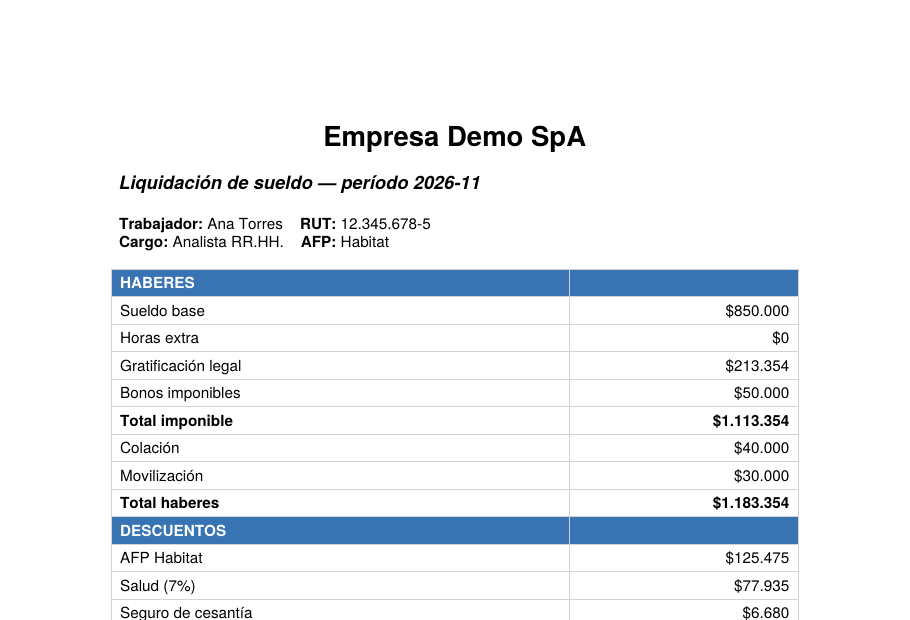

# Payroll Generator 🇨🇱

Automates Chilean payslip generation (*liquidaciones de sueldo*): reads employee data from an Excel spreadsheet, calculates earnings and legal deductions, and exports one PDF per employee plus a summary report.

> **Why I built this:** while working in an HR department, payslips were prepared by hand from Excel sheets — slow and error-prone. This tool turns that process into a single command.



## Features

- Reads and validates an Excel file with employee data (clear errors for missing columns or unknown AFP)
- Calculates:
  - Overtime pay based on weekly working hours (42h, 2026 rules)
  - Legal gratification (25%, capped at 4.75 minimum wages per year)
  - Pension (AFP 10% + each AFP's commission), health (7%) and unemployment insurance
- Generates a PDF payslip for each employee
- Exports a summary `.xlsx` with every payslip for the period
- All legal rates live in `config.json`, so they can be updated without touching code
- Unit tests with `pytest`

## Tech stack

Python · pandas · openpyxl · ReportLab · pytest

## Getting started

```bash
git clone https://github.com/<your-user>/payroll-generator.git
cd payroll-generator
python -m venv .venv
source .venv/bin/activate        # Windows: .venv\Scripts\activate
pip install -r requirements.txt

# Generate payslips for November 2026
PYTHONPATH=src python -m payroll.main data/trabajadores_ejemplo.xlsx --periodo 2026-11
# Windows (PowerShell): $env:PYTHONPATH="src"; python -m payroll.main data/trabajadores_ejemplo.xlsx --periodo 2026-11
```

Output is written to `output/`.

### Run the tests

```bash
pytest
```

## Input format

| rut | nombre | cargo | tipo_contrato | afp | sueldo_base | horas_extra | bonos_imponibles | colacion | movilizacion |
|---|---|---|---|---|---|---|---|---|---|
| 12.345.678-5 | Ana Torres | Analista RR.HH. | Indefinido | Habitat | 850000 | 0 | 50000 | 40000 | 30000 |

`tipo_contrato`: `Indefinido` or `Plazo Fijo`.

## Project structure

```
payroll-generator/
├── config.json          # legal rates and parameters
├── data/                # sample input
├── src/payroll/
│   ├── reader.py        # Excel reading and validation
│   ├── calculator.py    # payroll calculation
│   ├── pdf.py           # PDF generation
│   └── main.py          # command-line entry point
└── tests/
```

## Roadmap

- [ ] Income tax (*impuesto único de segunda categoría*) using the monthly UTM table
- [ ] Taxable income cap (*tope imponible* in UF)
- [ ] Private health plans (Isapre) with a plan amount in UF
- [ ] Fetch UF/UTM values automatically from an API
- [ ] Simple web interface (Streamlit) to upload the Excel and download a ZIP of payslips

## Disclaimer

Simplified model built for learning purposes. Rates in `config.json` are examples; check current official values before real use.
